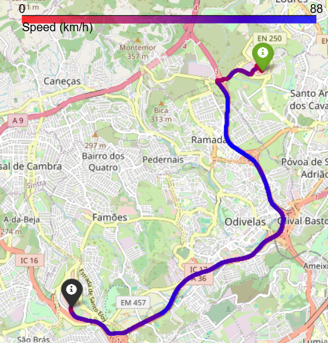
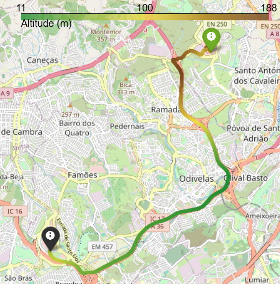
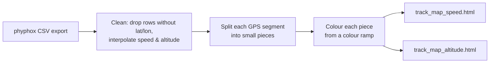

# PhyphoxGpsMapper

Turn a GPS track recorded with the [phyphox](https://phyphox.org/) app into interactive maps, with the route coloured by **speed** or by **altitude**.


<p align="center">
  
  
</p>

## Table of Contents

- [Features](#features)
- [Tech Stack](#tech-stack)
- [Project Structure](#input-data-format)
- [How it works](#how-it-works)
- [Getting Started](#getting-started)
- [Configuration](#configuration)
- [Input Data Format](#input-data-format)
- [Known Limitations](#known-limitations)

---

## Features

- Reads the CSV exported by phyphox's **Location (GPS)** experiment
- Generates two standalone, interactive HTML maps (open them in any browser):
  - **Speed map**: red (stopped) → blue (fastest)
  - **Altitude map**: green (low) → yellow → brown (high)
- Smooth colour gradient along the route (each GPS segment is subdivided)
- Start (green) and end (black) markers, plus a colour legend
- Handles missing values in the speed and altitude columns by interpolation
- Optional altitude smoothing and outlier-resistant speed scaling

---

## Tech stack

- [Python](https://www.python.org/) 3.9+
- [pandas](https://pandas.pydata.org/) and [NumPy](https://numpy.org/) for data handling
- [folium](https://python-folium.readthedocs.io/) (Leaflet.js) and [branca](https://python-visualization.github.io/branca/) for maps and legends
- OpenStreetMap tiles

---

## Project structure

```
phyphox-gps-mapper/
├── plot_track.py        # Main script: loads CSV, builds both maps
├── data/
│   └── ccLoures_ccUbbo_Raw_Data.csv     # Sample phyphox export
├── docs/
│   └── images/          # README screenshots
└── README.md
```

---

## How it works



Each segment between two GPS points is split into `SUBDIVISIONS` pieces. Each piece is coloured by linearly interpolating the value (speed or altitude) between the two endpoints, which gives a smooth gradient instead of one flat colour per segment.

---

## Getting started

### 1. Record and export your data

1. Install **phyphox** ([Android](https://play.google.com/store/apps/details?id=de.rwth_aachen.phyphox) / [iOS](https://apps.apple.com/app/phyphox/id1127319693)).
2. Open the **Location (GPS)** experiment and press play while you move.
3. Stop, then use the menu → **Export data** → **CSV**.
4. Unzip/copy the exported `Raw Data.csv` to your computer.

---

### 2. Install (Not tested!)

```bash
git clone https://github.com/notCandeias66/PhyphoxGpsMapper.git
cd phyphox-gps-mapper

python -m venv .venv
source .venv/bin/activate      # Windows: .venv\Scripts\activate

pip install numpy pandas folium
```

---

### 3. Run

Edit `CSV_PATH` at the top of `plot_track.py` so it points to your file:

```python
CSV_PATH = r"data/ccLoures_ccUbbo_Raw_Data.csv"
```

Then run:

```bash
python plot_track.py
```

Expected output:

```
Saved track_map_speed.html  (speed range 0 - X.X m/s = XX km/h)
Saved track_map_altitude.html  (altitude range XX - XXX m)
```

Open the two `.html` files in your browser.

---

## Configuration

All options are constants at the top of `plot_track.py`:

| Constant | Default | Description |
|---|---|---|
| `CSV_PATH` | *(local path)* | Path to the phyphox CSV file |
| `OUT_SPEED_HTML` | `track_map_speed.html` | Output file for the speed map |
| `OUT_ALT_HTML` | `track_map_altitude.html` | Output file for the altitude map |
| `SUBDIVISIONS` | `8` | Pieces per GPS segment. Higher = smoother gradient, larger HTML file |
| `MAX_SPEED_PERCENTILE` | `100` | Upper bound of the speed colour scale. Use e.g. `98` so a single GPS spike doesn't flatten the scale |
| `ALT_SMOOTH_WINDOW` | `1` | Rolling-median window for altitude (`1` = off). Try `5`–`11` for noisy GPS altitude |
| `SPEED_COLORS` | red → blue | RGB colour ramp for speed |
| `ALT_COLORS` | green → yellow → brown | RGB colour ramp for altitude |

---

## Input data format

The script expects the CSV exported by phyphox's **Location (GPS)** experiment. Columns are matched by name prefix, so encoding differences in the `°` symbol don't matter.

| Column | Used? | Notes |
|---|---|---|
| `Time (s)` | No | |
| `Latitude (°)` | Yes | Rows without lat/lon are dropped |
| `Longitude (°)` | Yes | |
| `Altitude (m)` | Yes | Interpolated where missing |
| `Speed (m/s)` | Yes | Contains `NaN`s, which are interpolated |
| `Altitude WGS84`, `Direction`, `Distance`, `Accuracy`, `Satellites` | No | Present in the export, ignored |

A sample file (centro comercial Continente Loures -> centro comercial UBBO) is included: [`data/ccLoures_ccUbbo_Raw_Data.csv`](data/ccLoures_ccUbbo_Raw_Data.csv).

---

## Known limitations

- Input path is hardcoded in the script (no CLI arguments yet).
- GPS altitude is noisy; use `ALT_SMOOTH_WINDOW` to reduce it.
- Output files get large for long tracks, since each segment becomes `SUBDIVISIONS` map objects.
